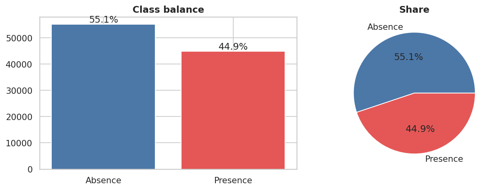
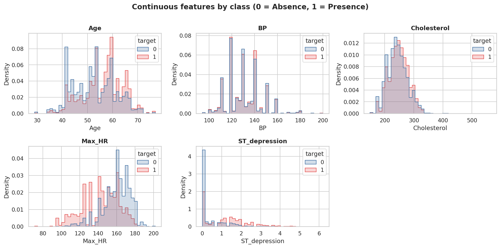
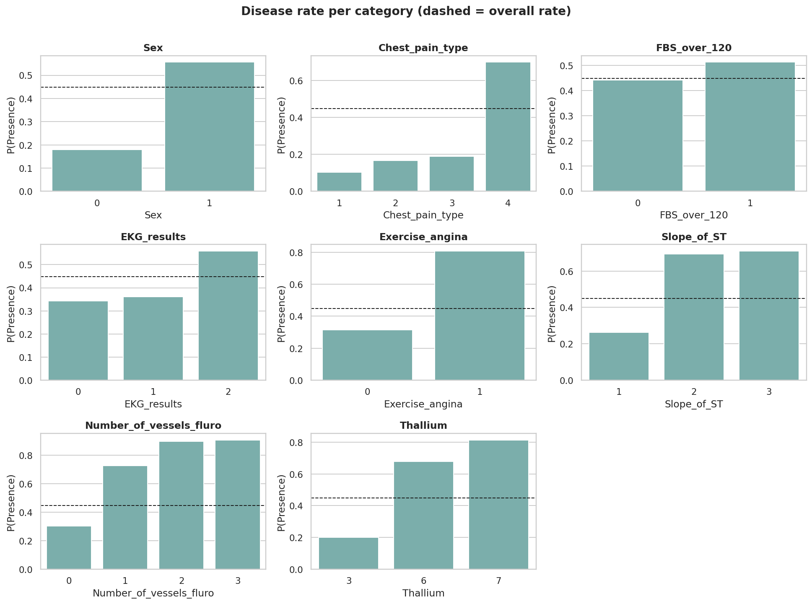
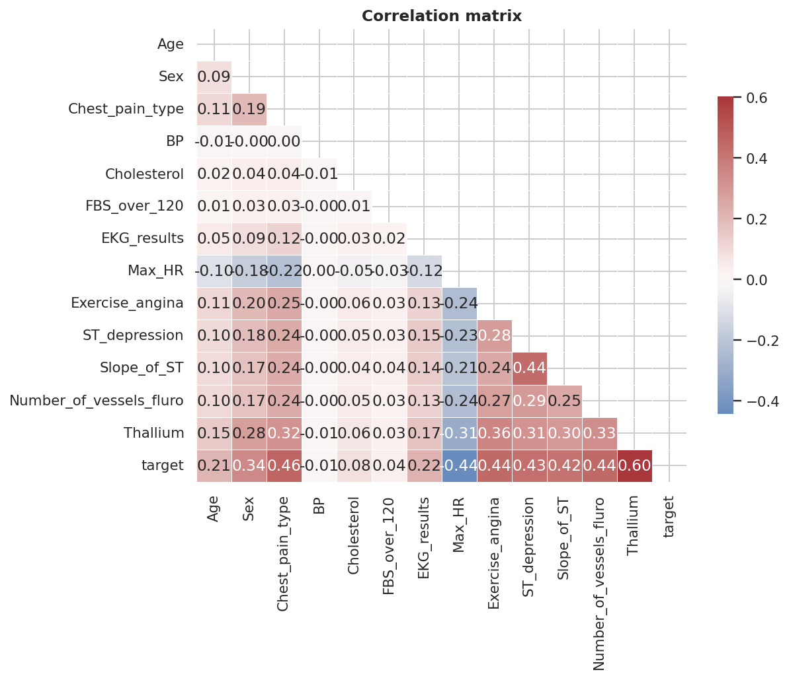
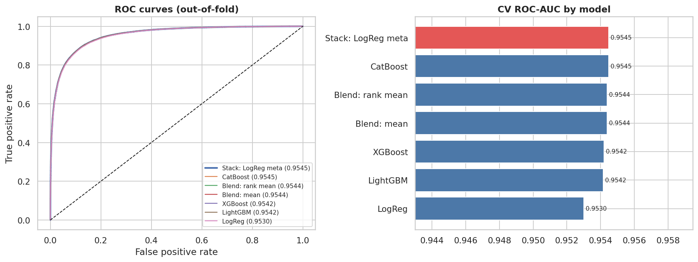
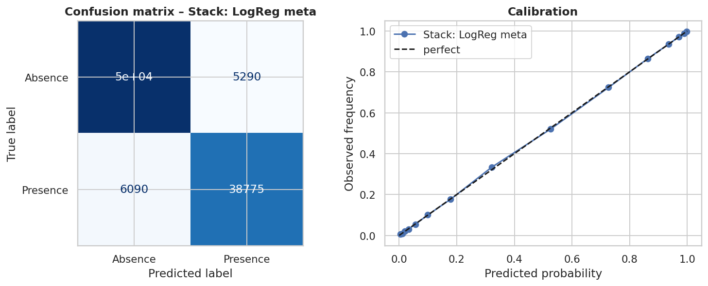
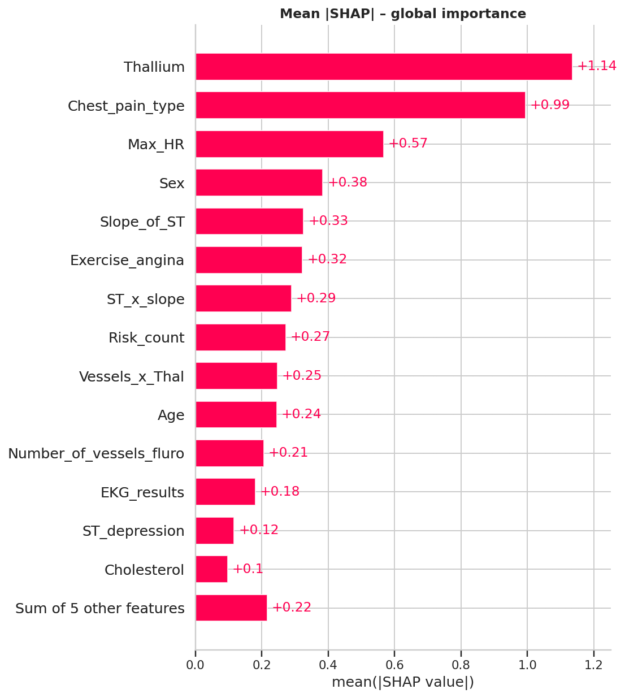
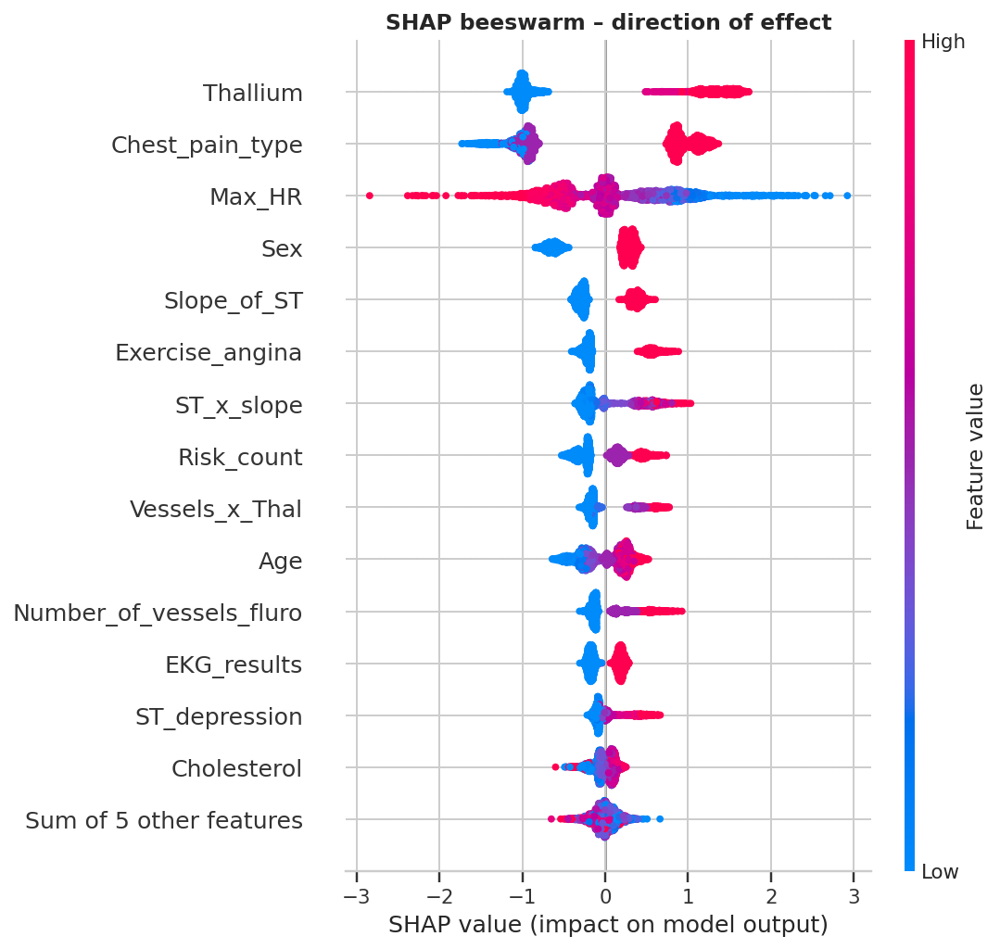

# ❤️ Predicting Heart Disease 

[](https://colab.research.google.com/github/YOUR_GITHUB_USERNAME/heart-disease-prediction-s6e2/blob/main/notebooks/heart_disease_s6e2.ipynb)


> **Run it in one click:** press the *Open in Colab* badge, upload the three competition CSVs to Colab (or mount Drive), and choose *Runtime → Run all*.

## 🎯 Problem
Predict whether a patient has heart disease (`Presence` / `Absence`) from 13 clinical features
(age, sex, chest-pain type, blood pressure, cholesterol, max heart rate, ST depression, number of fluoroscopy vessels, thallium test, …).
The competition is scored with **ROC-AUC** on predicted probabilities.

## 📦 Dataset
* Source: Kaggle competition data (not redistributed here – download it from the competition's Data tab after accepting the rules).
* Synthetic: generated by a deep-learning model trained on the classic heart-disease dataset, so findings are **not clinical evidence**.
* 630,000 training rows, 270,000 test rows, no missing values.

## 🧠 Approach
1. **EDA** – class balance, per-class distributions, disease rate by category, correlations, train/test drift (KS test).
2. **Feature engineering** – target-free, row-wise features (heart-rate reserve, ST × slope, vessels × thallium, risk count, …) so validation folds can never leak.
3. **Models** – Logistic Regression baseline, LightGBM, XGBoost, CatBoost with stratified 5-fold CV and early stopping.
4. **Ensembling** – probability mean, rank mean and a logistic-regression stacker on out-of-fold logits.
5. **Explainability** – SHAP global importance and beeswarm plots.
6. **Submission** – `submissions/submission.csv` in the competition format.

## 📊 Results
⚡ *Quick mode: 100,000 of 630,000 training rows. Re-run with `QUICK = False` for full-data scores.*

| Model | CV ROC-AUC |
|---|---|
| **Stack: LogReg meta** | 0.95448 |
| CatBoost | 0.95447 |
| Blend: rank mean | 0.95439 |
| Blend: mean | 0.95438 |
| XGBoost | 0.95421 |
| LightGBM | 0.95415 |
| LogReg | 0.95300 |

Selected for submission: **Stack: LogReg meta**. Total runtime of this run: ~11 min.

Most influential features (mean |SHAP|):

| Feature | Importance |
|---|---|
| Thallium | 1.1359 |
| Chest_pain_type | 0.9939 |
| Max_HR | 0.5669 |
| Sex | 0.3840 |
| Slope_of_ST | 0.3263 |
| Exercise_angina | 0.3229 |
| ST_x_slope | 0.2889 |
| Risk_count | 0.2725 |

Context: public write-ups of this competition report out-of-fold AUCs around 0.955 for strong ensembles, with gains
flattening because of label noise in the synthetic data.

## 🖼️ Figures
















## 🗂️ Repository structure
```
├── notebooks/heart_disease_s6e2.ipynb   # the full pipeline (run on Colab)
├── reports/
│   ├── metrics.json                      # machine-readable results
│   ├── leaderboard.csv                   # CV scores of every model
│   └── figures/                          # all plots used above
├── submissions/                          # generated submission (git-ignored)
├── data/                                 # Kaggle data (git-ignored)
├── requirements.txt
└── LICENSE
```

## 🚀 Quickstart
**Colab (recommended):** open the badge above → upload `train.csv`, `test.csv`, `sample_submission.csv` (or mount Drive) → *Run all*.

**Local:**
```bash
git clone https://github.com/YOUR_GITHUB_USERNAME/heart-disease-prediction-s6e2.git && cd heart-disease-prediction-s6e2
pip install -r requirements.txt
# put train.csv, test.csv, sample_submission.csv into data/ (or set DATA_PATH), then:
jupyter lab notebooks/heart_disease_s6e2.ipynb
```
Set `QUICK = False` in the configuration cell for the full-data run; set `USE_GPU = True` on a GPU machine.

## ⚠️ Limitations & responsible use
* Data is synthetic; do not use these models or insights for any medical decision.
* Early stopping on the validation fold makes OOF AUC slightly optimistic.
* Public leaderboard score may differ from CV because of the competition's noisy labels.

## 👤 Author
Mohsin Ali Arshad — AI Engineer · AI/ML Certified · [GitHub](https://github.com/YOUR_GITHUB_USERNAME)

## 📄 License
MIT – see [LICENSE](LICENSE). Competition data remains subject to the Kaggle competition rules.
